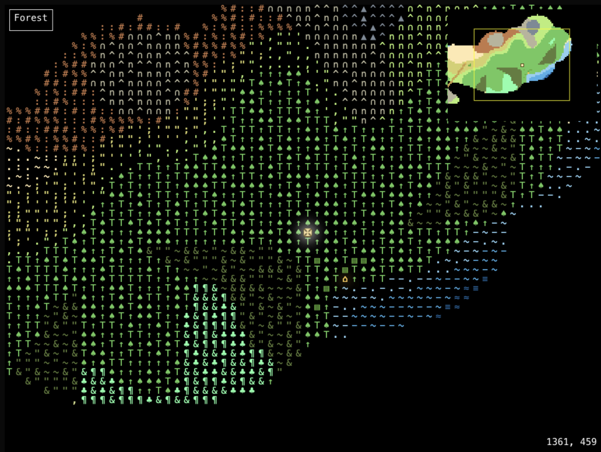
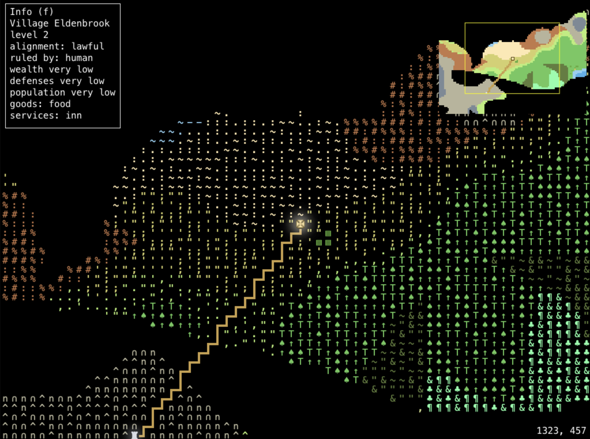
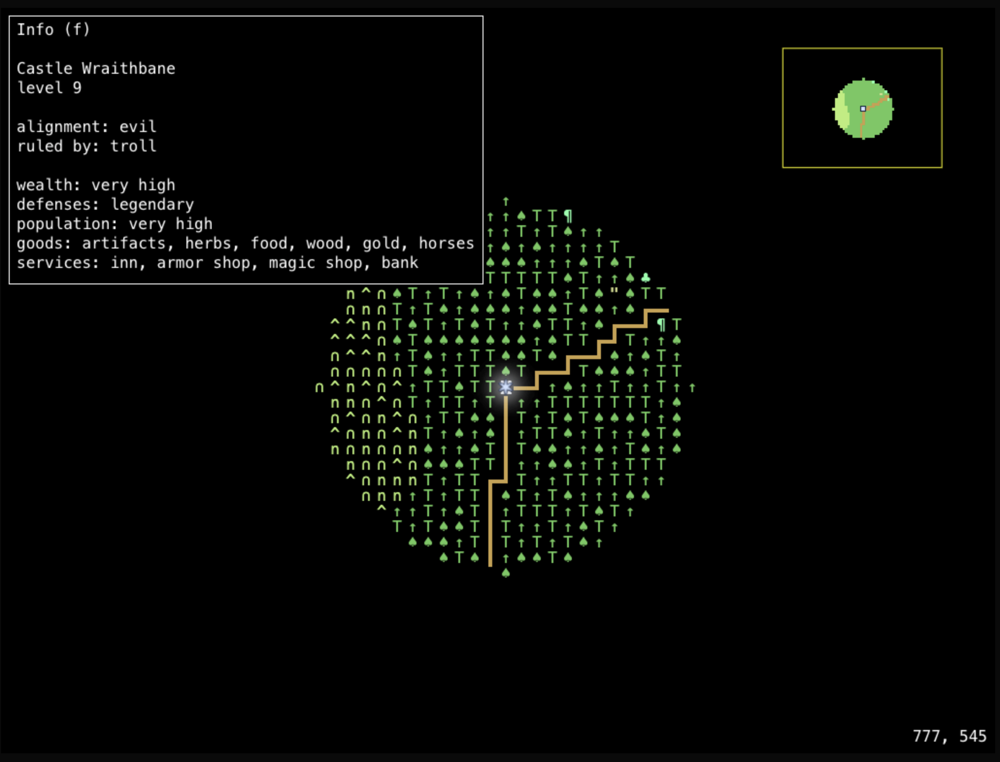
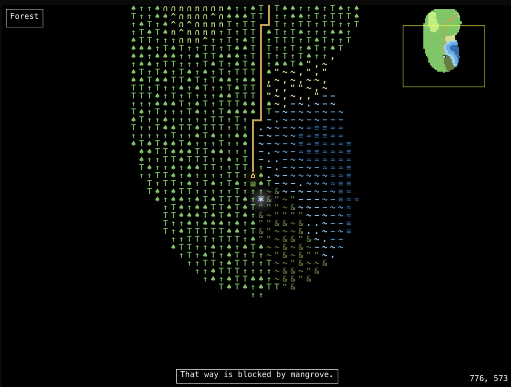
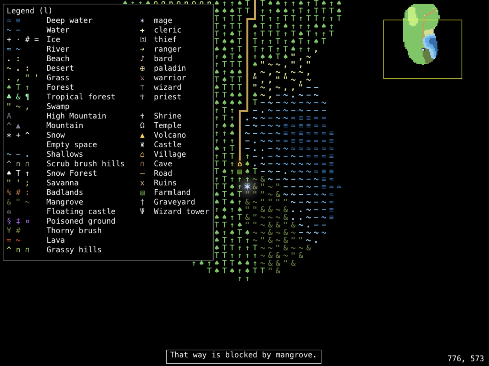

# Text World

Text World is a very early attempt to mash up a roguelike with [Dwarf Fortress](http://www.bay12games.com/dwarves/) and [Final Fantasy Tactics](https://www.square-enix-games.com/en_US/games/final-fantasy-tactics). The world is a large, seed-generated map drawn with colored glyphs. You walk a small party across it, read the land, and try to recruit people at the places you find.

This is incomplete. Gather, mine, search, dig, pray, entering sites, and combat are only sketched in. The project is a side project by [jason.lough@gmail.com](mailto:jason.lough@gmail.com). Anyone can contribute.

## Screenshots

The image files are in [`public`](public).

Explored forest, hills, and a coast. Unseen ground stays black, and the minimap marks the current view.



Tile info for Village Eldenbrook, a level 2 lawful village on the road.



Tile info for Castle Wraithbane, a level 9 evil castle ruled by a troll.



Movement stops at terrain the character cannot cross.



The legend lists terrain glyphs and character classes.



## Features

- A procedural world, 2048 by 1536 tiles, built from a random seed. Elevation, moisture, and latitude pick biomes, then rivers, shores, and sites are placed on top.
- Glyph terrain: ocean, ice, rivers, beaches, desert, grassland, forest, tropical forest, swamp, hills, mountains, snow, savanna, badlands, mangrove, lava, poisoned ground, thorny brush, farmland, roads, ruins, volcanoes, and empty voids.
- Named sites with a lawful or evil alignment: villages, castles, floating castles, temples, shrines, caves, graveyards, and wizard towers. Castles, villages, temples, and shrines also carry a ruler, level, wealth, defenses, population, goods, and services.
- Fog of war. Tiles stay dark until a party member walks near them. The minimap shows only explored ground.
- A party of up to 16 characters. A new game starts with one character near a castle, holding a generated item.
- Nine classes (warrior, paladin, ranger, thief, bard, mage, wizard, cleric, priest) and nine races (human, elf, dwarf, gnome, orc, troll, goblin, kobold, giant). Race sets alignment: the first four are lawful, the rest evil.
- Six stats (strength, dexterity, constitution, intelligence, wisdom, charisma), hit points, experience, and skills for recruit, search, pray, gather, dig, and mine. Class and race both change the numbers.
- Recruiting at a village, castle, temple, shrine, wizard tower, or floating castle. Success depends on the recruit skill, whether your alignment matches the place, and a short cooldown. Each site only yields so many followers.
- Terrain that blocks travel. Water, ice, mountains, lava, thorns, poison, voids, and similar ground stop you, and the game says what is in the way. Gear for swimming, climbing, flight, and protection is planned; those tiles still cannot be crossed.
- A game-over state when no one in the party is alive.

## Inputs

The game is keyboard-first. One info panel is open at a time; press the same key again to close it.

| Key        | Action                                                                                         |
| ---------- | ---------------------------------------------------------------------------------------------- |
| Arrow keys | Move the selected character one tile                                                           |
| Tab        | Select the next living party member                                                            |
| `h`        | Help                                                                                           |
| `l`        | Legend of terrain glyphs and character classes                                                 |
| `f`        | Info for the tile you are standing on                                                          |
| `c`        | Character sheet for the selected member                                                        |
| `i`        | Inventory                                                                                      |
| `m`        | Map census (site counts, lawful and evil, seed)                                                |
| `z`        | Cycle the minimap: local, whole world, hidden                                                  |
| `r`        | Recruit, if this character has the skill and the site allows it                                |
| `g`        | Gather (class skill; not finished)                                                             |
| `n`        | Mine (class skill; not finished)                                                               |
| `s`        | Search the area (not finished)                                                                 |
| `d`        | Dig (class skill; not finished)                                                                |
| `p`        | Pray (class skill; not finished)                                                               |
| `e`        | Enter a town, shrine, graveyard, cave, dungeon, castle, temple, or similar site (not finished) |

Click or drag the minimap to move the camera. The view recenters on the selected character when you move or switch party members.

## Running it

Text World is a React app built with Next.js. You need [Node.js](https://nodejs.org/) and npm.

```bash
npm install
npm run dev
```

Open [http://localhost:3000](http://localhost:3000). The page reloads as you edit the code.

To run a production build locally:

```bash
npm run build
npm start
```

## Contributing

The game is in its first stages, and contributions are welcome. Note that there is a strong preference to NOT include any more packages in package.json. Interested? Open a pull request. Questions can go to [jason.lough@gmail.com](mailto:jason.lough@gmail.com).
